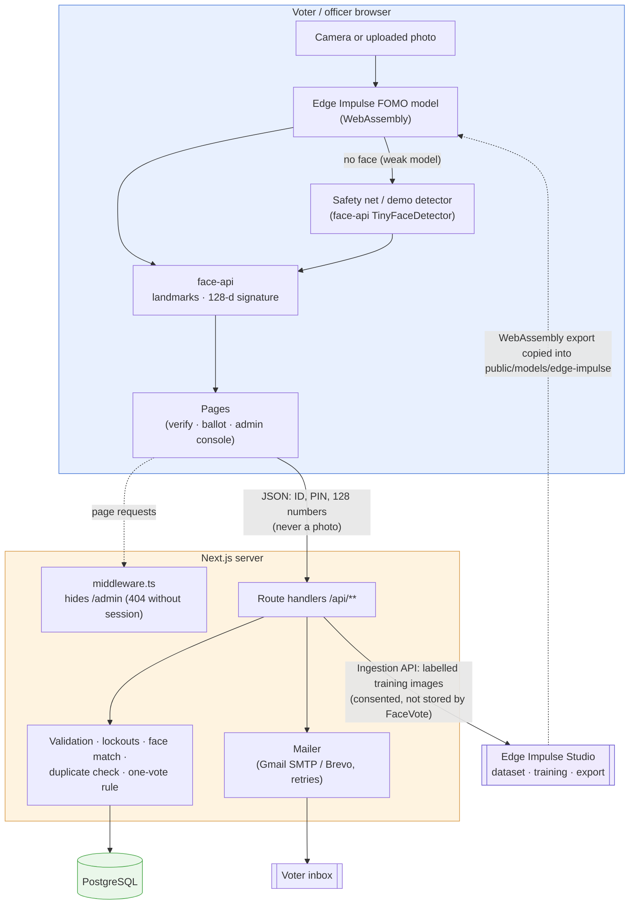
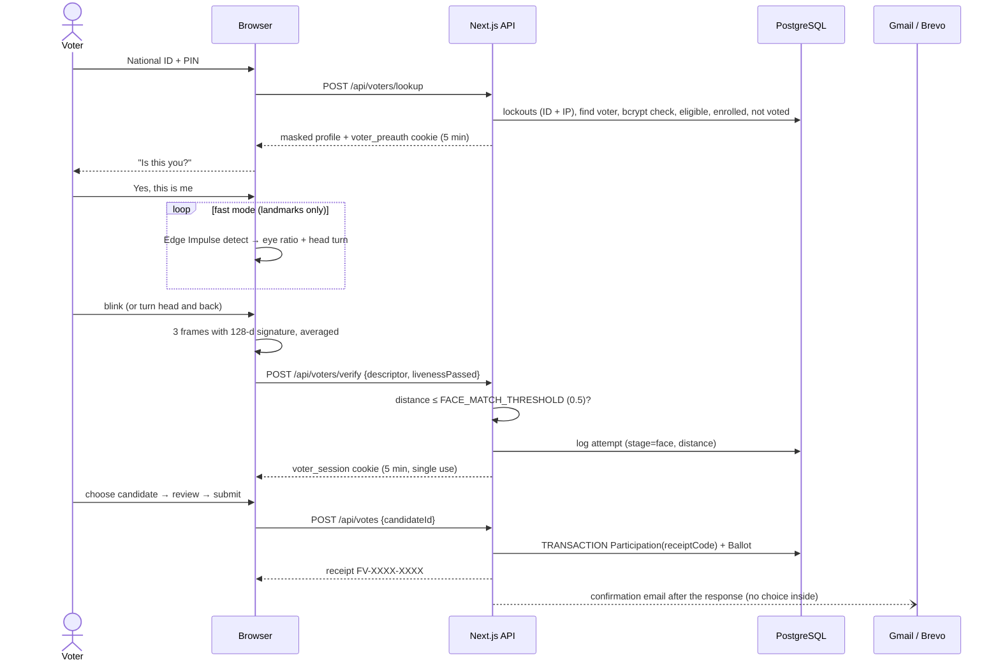
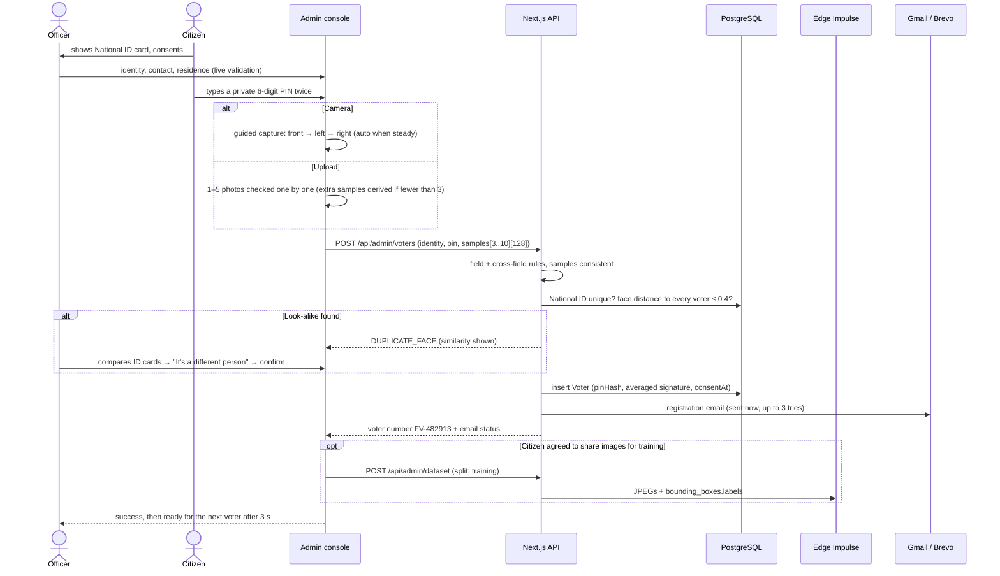
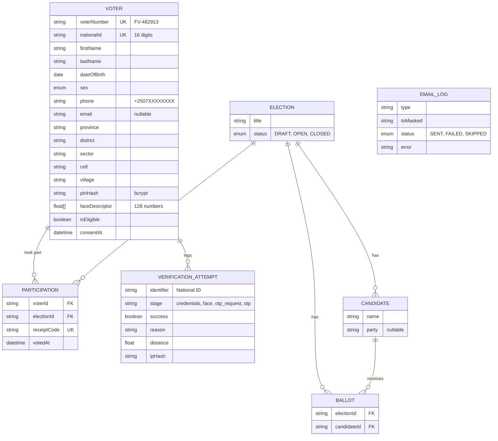

<div align="center">
  

# FaceVote

**A face-verified e-voting system. Voters prove who they are with their Rwandan National ID, a PIN and a live face check, then cast one secret ballot. The face detector is trained and deployed with Edge Impulse.**


*Built for the CMU-Africa Bridge Program.*

</div>

> **Prototype.** FaceVote shows how biometric verification, a secret ballot and an on-device ML model can work together. It has not been audited for use in a real election. See [Limitations](#18-limitations).

---

## Table of contents

1. [Overview](#1-overview)
2. [The problem](#2-the-problem)
3. [Features by role](#3-features-by-role)
4. [Tech stack](#4-tech-stack)
5. [System architecture](#5-system-architecture)
6. [How Edge Impulse is used](#6-how-edge-impulse-is-used)
7. [Voting flow](#7-voting-flow)
8. [Voter registration flow](#8-voter-registration-flow)
9. [Forgot PIN flow](#9-forgot-pin-flow)
10. [Security and privacy](#10-security-and-privacy)
11. [Database schema](#11-database-schema)
12. [API reference](#12-api-reference)
13. [Screens](#13-screens)
14. [Repository structure](#14-repository-structure)
15. [Getting started](#15-getting-started)
16. [Scripts and testing](#16-scripts-and-testing)
17. [Engineering decisions](#17-engineering-decisions)
18. [Limitations](#18-limitations)
19. [Roadmap](#19-roadmap)
20. [Troubleshooting](#20-troubleshooting)

---

## 1. Overview

FaceVote has two parts:

- **A voter website.** A voter enters their National ID and PIN, checks that the registered details shown are theirs, proves they are a live person (blink or head turn), passes a 1:1 face match and casts one secret ballot. They receive a participation reference on screen and by email. The email never contains their choice.
- **A hidden admin console for election officers.** Officers register voters against their National ID card, with guided face capture, run elections, monitor verification attempts, collect training images for the face detector and manage the email and Edge Impulse integrations.

The face pipeline runs **in the voter's browser**. An **Edge Impulse object-detection model (FOMO), exported to WebAssembly**, finds the face in each camera frame. Pretrained face-api networks then produce eye/head landmarks for liveness and a 128-number face signature. The **server** makes every decision: PIN check, face distance threshold, eligibility, lockouts and the one-vote rule.

**At a glance:** 3 roles · 21 API routes · 7 database tables · Rwandan National ID validation · guided 3-pose face capture with photo-upload fallback · duplicate-face detection · Edge Impulse data collection, training and in-browser inference · email via Gmail or Brevo · PIN reset by one-time code · light, dark and system themes · no face photos stored by the app.

## 2. The problem

Paper ballots and simple online polls make it hard to guarantee that:

- the person voting is the registered voter, and not someone holding their card or password;
- each person votes **once**;
- nobody can link a voter to their choice;
- results can be counted instantly and checked for consistency.

Face recognition alone is not the answer either. Picking a face out of everyone enrolled ("who is this?") is error-prone, and a printed photo can fool a naive camera check.

FaceVote uses **1:1 verification**: the voter *claims* an identity with their National ID and PIN, and the system only checks whether the live face matches **that** voter's enrolled face. A liveness challenge blocks printed photos. Who voted and what they voted are stored in separate tables that cannot be joined.

## 3. Features by role

| Role | What they can do |
| --- | --- |
| **Voter** | Enter National ID + 6-digit PIN · see "Is this you?" with their registered name, date of birth, address and masked contact details · pass liveness (blink, or turn the head and back) · 1:1 face match · choose a candidate, review, submit within a 5-minute session · get a participation reference on screen and by email · reset a forgotten PIN with a one-time code sent to their registered email |
| **Election officer** | Sign in at a secret, unlinked URL · register voters with full Rwandan identity (National ID, names, date of birth, sex, phone, email, province → district → sector → cell → village), a private PIN and consent · capture the face with **guided front / left / right auto-capture** or **upload 1–5 photos** · see duplicate-ID and duplicate-face warnings · create elections, add candidates, open / close voting · view results, turnout and an integrity check · suspend or restore voters · resend registration and vote-confirmation emails · see every verification attempt and a face-distance histogram |
| **Researcher / developer** | **Collect training images straight into Edge Impulse** (faces with bounding boxes, backgrounds without) · choose Training / Test split · see the model card (metrics, dataset, confusion matrix) · live test bench: detector, confidence, FPS, eye ratio, head turn, brightness, face-distance tester, and how many faces were found by the trained model vs the safety net |

## 4. Tech stack

| Layer | Technology |
| --- | --- |
| Face detection (trained model) | **Edge Impulse** FOMO object detector, label `face`, 96×96 grayscale, exported as **WebAssembly** and run in the browser |
| Face landmarks, signature, liveness | [`@vladmandic/face-api`](https://github.com/vladmandic/face-api): 68 landmarks, 128-d face descriptor, TinyFaceDetector and SSD MobileNet for photo uploads |
| Frontend | **Next.js 15** (App Router), **React 19**, **TypeScript**, **Tailwind CSS v4** with design tokens for light / dark / system themes, `lucide-react` icons |
| Backend | Next.js Route Handlers, **Zod** validation shared with the browser, `jose` (HS256 JWT cookies), `bcryptjs` |
| Database | **PostgreSQL** with **Prisma 6** (schema and migrations in `prisma/`) |
| Email | **Gmail SMTP with an App Password** (`nodemailer`) or **Brevo** API, switchable by `EMAIL_PROVIDER` |
| Edge Impulse integration | Studio API (project info) and **Ingestion API** (labelled image upload), free plan |
| Tooling | `tsx` scripts, Prisma Studio, Docker Compose (optional PostgreSQL) |

## 5. System architecture



**Design principles**

- **The server decides; the browser measures.** The browser sends a 128-number signature and a liveness flag. The threshold and the decision live on the server.
- **Verification, not identification.** One live face is compared with one enrolled face. The system never searches everyone.
- **Detection and identity are different jobs.** The Edge Impulse model finds faces. A pretrained embedding model tells people apart, so registering a new voter never requires retraining.
- **Integrity lives in the database.** "One person, one vote" is a `UNIQUE (voterId, electionId)` constraint inside a transaction.
- **Integrations never block voting.** Email and Edge Impulse failures are logged and retryable; the vote itself is never lost.

## 6. How Edge Impulse is used

Edge Impulse is the machine-learning part of the project: data is collected **from inside FaceVote**, labelled automatically, trained in Edge Impulse Studio and deployed back into the app as WebAssembly.

```mermaid
flowchart LR
    A["Admin → Data collection<br/>or voter registration<br/>(consent recorded)"] -->|"JPEG + bounding_boxes.labels<br/>Ingestion API"| B["Edge Impulse dataset<br/>Training / Test"]
    B --> C["Review boxes<br/>(labelling queue)"]
    C --> D["Impulse: 96×96 squash<br/>Image (grayscale)<br/>Object detection"]
    D --> E["Train FOMO<br/>MobileNetV2"]
    E --> F["Model testing<br/>F1 · confusion matrix"]
    F --> G["Deployment →<br/>WebAssembly (int8)"]
    G --> H["public/models/edge-impulse/<br/>edge-impulse-standalone.js + .wasm"]
    H --> I["Runs in the browser<br/>on every camera frame"]
```



### 6.1 Collecting data from the app

- **Admin → Data collection** captures camera frames and uploads them to the project linked to `EDGE_IMPULSE_API_KEY`:
  - **Capture face / Burst ×5:** only when a face is visible. Each image is sent with its face box(es), so it arrives in Edge Impulse **already labelled `face`**.
  - **Capture background:** only when no face is visible. Sent with an empty box list, so the model learns "nothing here". No separate label is needed.
  - **Send images to:** Training, Test or Auto 80/20.
  - A consent box and an anonymous subject code (e.g. `VOL-03` or a voter number) are required for face images. Names are never sent.
- **Voter registration** can also contribute the 3 captured photos (separate consent checkbox). They are always sent to **Training**.
- Uploads are a single multipart body with an exact `Content-Length` and are retried once on a network error. FaceVote keeps no copy of the images.

### 6.2 Training settings used

| Step | Setting |
| --- | --- |
| Labelling method | Bounding boxes (object detection), label `face` |
| Impulse | Image 96×96, resize **Squash**, Image block (**Grayscale**), Object Detection block |
| Model | **FOMO** (Faster Objects, More Objects) on MobileNetV2 |
| Training | 60 cycles (100+ for small datasets), learning rate 0.001, data augmentation on, 20% validation |
| Deployment | **WebAssembly**, quantized (int8) |

### 6.3 Using the model in the app

`src/lib/edge-impulse.ts` loads `edge-impulse-standalone.js`, which initialises the WASM runtime. For each frame the app:

1. squashes the frame to the model's input size (read from `get_properties()`);
2. packs each pixel as one number `0xRRGGBB`, as Edge Impulse expects;
3. calls `run_classifier()` and reads the boxes (`label`, `value`, `x`, `y`, `width`, `height`);
4. keeps boxes labelled `face` above `NEXT_PUBLIC_EDGE_IMPULSE_MIN_CONFIDENCE`, scales them to the video and merges nearby FOMO boxes (FOMO marks face centres on a grid, so one face can produce several boxes).

**Detector modes** (shown under every camera and on **Admin → AI model**):

| Mode | When | Label |
| --- | --- | --- |
| Trained Edge Impulse model | Export files present in `public/models/edge-impulse/` | *Edge Impulse* + "face found by your model" or "safety net used" |
| Demo model | No export yet (`NEXT_PUBLIC_DEMO_MODEL="true"`) | *Edge Impulse · demo model* (same output format as an export) |
| face-api | Edge Impulse disabled | *face-api (fallback)* |

The **safety net** (`NEXT_PUBLIC_EDGE_IMPULSE_FALLBACK="true"`) is for an early, under-trained model: when the Edge Impulse model finds no face in a frame, face-api's detector is used for that frame so registration and voting keep working, and the UI says which detector found the face. Turn it off once the model is accurate.

### 6.4 Model card and current results

`public/models/edge-impulse/model-card.json` drives the **AI model** page (metrics, dataset, confusion matrix, on-device performance).

| Version | Data | Model | Result |
| --- | --- | --- | --- |
| **v1** | 20 images: 12 faces (4 people × 3) + 8 backgrounds | FOMO MobileNetV2 0.1, 60 cycles | F1 0.00: too little data, the model predicts background everywhere. Deployed end-to-end with the safety net on. |
| v2 (planned) | ~200 faces from more people and conditions + ~40 backgrounds, ~20% test | FOMO MobileNetV2 0.35, 100 cycles | Target F1 ≥ 0.85, then safety net off |

Step-by-step guides: [`docs/EDGE_IMPULSE_QUICK_STEPS.md`](docs/EDGE_IMPULSE_QUICK_STEPS.md) (short checklist) and [`docs/MODEL_TRAINING.md`](docs/MODEL_TRAINING.md) (full guide with a report checklist).

## 7. Voting flow



## 8. Voter registration flow



**Guided capture** coaches the person from each frame: too dark / too bright, move closer / back, centre the face (with arrows), only one person, eyes open, turn more / less, hold still. A shot is taken automatically after about 0.5 s in the right pose. A **Capture anyway** button appears after 8 s, and **Upload photos instead** appears if the camera doesn't start.

**Photo upload** keeps the photo at full resolution, finds faces on a 1280 px copy (TinyFaceDetector 608 → SSD MobileNet fallback), uses the largest face only if it clearly dominates, rejects faces under 40 px, and computes the signature on a crop from the original so small faces stay sharp. Each photo gets a plain reason when rejected (e.g. "3 people in this photo", "the face is too small… crop it", "can't be opened here (e.g. HEIC)").

## 9. Forgot PIN flow

1. The voter clicks **Forgot your PIN?** and enters their National ID.
2. A **6-digit code** is emailed to the registered address. It is valid for 10 minutes, single use, can be resent after 60 s, and at most 3 codes are sent per 15 minutes.
3. The voter enters the code (5 wrong tries max) and chooses a new PIN. The same strength rules apply, and it must differ from the old one.
4. A "your PIN was changed" security email is sent.

The code is never stored in plain text: the reset cookie holds an HMAC of it, and a fingerprint of the current PIN hash makes the code useless once the PIN has changed.

## 10. Security and privacy

- **Three factors, in order:** a valid National ID, a 6-digit PIN (bcrypt, cost 10) and a live face. Personal details are shown only after the PIN is verified, and contact details stay masked.
- **Liveness:** a blink (eye ratio below 82% of the person's open level, then back above 92%) or a head turn measured from the person's own starting angle. Both run on fast landmark-only frames so short blinks aren't missed.
- **Lockouts:** 5 failures (PIN, face or reset code) per National ID → 15-minute lock with the exact retry time. 30 failures per client IP → temporary block. IPs are stored only as salted hashes.
- **Short, single-purpose sessions:** `voter_preauth` (5 min) → `voter_session` (5 min, one ballot). HS256 JWTs in `httpOnly`, `SameSite=Strict` cookies, `Secure` in production.
- **Registration integrity:** Rwandan ID structure (citizen digit, birth year, sex digit), date of birth and sex must match the ID, age ≥ 18, district must belong to the province, MTN/Airtel phone format, weak PINs rejected, duplicate National IDs rejected, look-alike faces flagged for officer confirmation.
- **Secret ballot:** `Ballot` has no `voterId` and no timestamp. The participation reference proves participation only. Emails never contain the choice.
- **Hidden admin console:** no public links. Every `/admin` URL returns 404 without a session, login lives at a secret path (`ADMIN_LOGIN_PATH`), pages are `noindex`, the session is re-checked on the server, and every admin API checks `isAdmin()`.
- **Clear, safe errors:** every API error returns a stable `code`, a plain-language `error` and an actionable `hint`. Registration status is disclosed (as public register checks do); personal data is not.
- **Privacy:** FaceVote stores no face photos, only the 128-number signature. Training images go only to the Edge Impulse project, with consent. Keys and passwords stay in `.env` on the server.

## 11. Database schema



Key constraints: `UNIQUE (voterId, electionId)` on Participation (one vote) · `UNIQUE nationalId` (one registration) · `count(Ballot) = count(Participation)` per election (integrity check on the dashboard) · attempts outlive deleted voters (`SET NULL`).

## 12. API reference

Every error has the shape `{ "ok": false, "code": "WRONG_PIN", "error": "The PIN is incorrect.", "hint": "You have 3 attempts left…", "fieldErrors": { … } }`.

**Voter**

| Method | Route | Purpose |
| --- | --- | --- |
| GET | `/api/candidates` | Open election and candidates |
| POST | `/api/voters/lookup` | Step 1: National ID + PIN → masked profile, pre-auth cookie |
| POST | `/api/voters/verify` | Step 2: liveness + 1:1 face match → voting session |
| POST | `/api/votes` | Step 3: cast one ballot → receipt, confirmation email |
| DELETE | `/api/session` | Cancel |
| POST | `/api/voters/pin-reset/request` | Email a one-time code |
| POST | `/api/voters/pin-reset/verify` | Check the code |
| POST | `/api/voters/pin-reset/complete` | Set the new PIN |

**Admin** (session required)

| Method | Route | Purpose |
| --- | --- | --- |
| POST | `/api/admin/login`, `/api/admin/logout` | Sign in / out |
| GET, POST | `/api/admin/voters` | List / register voters |
| PATCH | `/api/admin/voters/:id` | Suspend / restore |
| POST | `/api/admin/voters/:id/email` | Resend registration details or vote confirmation |
| GET | `/api/admin/results` | Tallies, turnout, integrity |
| POST | `/api/admin/elections` | Create election (draft) |
| PATCH | `/api/admin/elections/:id` | Open / close voting |
| POST | `/api/admin/candidates` | Add candidate |
| POST | `/api/admin/dataset` | Upload labelled images to Edge Impulse |
| POST | `/api/admin/integrations/test-email` | Send a test email |

## 13. Screens

| Area | Route | What it shows |
| --- | --- | --- |
| Voter | `/` | Open election, candidates, how it works, security |
| Voter | `/verify` | National ID + PIN → "Is this you?" → camera with oval guide and live checklist |
| Voter | `/vote` | Ballot with a 5-minute countdown, review, submit |
| Voter | `/confirmation` | Participation reference and where the email went |
| Voter | `/forgot-pin` | National ID → emailed code → new PIN |
| Admin | `ADMIN_LOGIN_PATH` | Officer sign-in (the default `/admin/login` returns 404 when a secret path is set) |
| Admin | `/admin` | Stats, live results, integrity check, model status, recent attempts |
| Admin | `/admin/elections` | Elections, candidates, open / close |
| Admin | `/admin/voters` | Registration (guided capture / upload) and the voter register |
| Admin | `/admin/activity` | Verification log, rejection reasons, locked IDs, distance histogram |
| Admin | `/admin/model` | Model card, confusion matrix, live test bench |
| Admin | `/admin/dataset` | Edge Impulse data collection |
| Admin | `/admin/integrations` | Email and Edge Impulse status, test email, email log |

## 14. Repository structure

```
face-evoting/
├── docs/
│   ├── EDGE_IMPULSE_QUICK_STEPS.md   # short checklist: connect, collect, train, deploy
│   └── MODEL_TRAINING.md             # full Edge Impulse guide + report checklist
├── prisma/
│   ├── schema.prisma                 # 7 tables
│   ├── migrations/                   # versioned SQL migrations
│   ├── seed.ts                       # demo election + candidates
│   └── seed-demo.ts                  # optional sample data for the dashboard
├── public/
│   ├── logo.svg
│   ├── candidates/                   # candidate placeholder images
│   └── models/
│       ├── face-api/                 # copied from node_modules on install (git-ignored)
│       └── edge-impulse/
│           ├── model-card.json       # metrics shown on the AI model page
│           └── (edge-impulse-standalone.js + .wasm from your export)
├── scripts/                          # model copy, self-checks, diagnostics, voter tools
└── src/
    ├── middleware.ts                 # hides /admin, serves the secret login path
    ├── app/
    │   ├── (public)/                 # voter site: home, verify, vote, confirmation, forgot-pin
    │   ├── admin/                    # login + console: overview, elections, voters, activity,
    │   │                             #   model, dataset, integrations
    │   └── api/                      # route handlers (voter + admin)
    ├── components/                   # FaceCamera, FaceEnrollment, ThemeToggle, UI kit
    └── lib/
        ├── edge-impulse.ts           # loads and runs the WASM export (browser)
        ├── edge-impulse-api.ts       # Studio + Ingestion API (server)
        ├── demo-model.ts             # stand-in with the export's output format
        ├── face-pipeline.ts          # detect → crop → landmarks → signature, liveness, photo scan
        ├── face-match.ts             # distance, consistency (server)
        ├── rwanda.ts                 # National ID, phone, districts, masking
        ├── validation.ts             # Zod schemas shared by browser and server
        ├── attempts.ts · auth.ts · pin-reset.ts · receipt.ts
        └── email/                    # mailer (Gmail/Brevo), templates, voter emails
```

## 15. Getting started

### Prerequisites

| Tool | Used for |
| --- | --- |
| Node.js 20+ | Next.js, Prisma, scripts |
| PostgreSQL 14+ | Database (local install, or `docker compose up -d db`) |
| Chrome or Edge with a webcam | Face capture (camera works on `localhost` or HTTPS) |
| Edge Impulse account (free) | Training data and model |
| Gmail account with 2-Step Verification | Sending emails (or a Brevo account) |

### Install and run

```bash
git clone https://github.com/Mr-Olivier/face-evoting.git
cd face-evoting
npm install                      # also generates Prisma client and copies face models
cp .env.example .env             # Windows PowerShell: copy .env.example .env
npx prisma migrate deploy        # create the tables
npm run db:seed                  # demo election + 3 candidates
npm run dev                      # http://localhost:3000
```

### Configuration (`.env`)

| Variable | Purpose |
| --- | --- |
| `DATABASE_URL` | PostgreSQL connection string (URL-encode special characters) |
| `JWT_SECRET` | Long random string for session tokens: `node -e "console.log(require('crypto').randomBytes(48).toString('hex'))"` |
| `ADMIN_PASSWORD` | Admin console password |
| `ADMIN_LOGIN_PATH` | Secret URL of the admin login, e.g. `/your-secret-path` |
| `FACE_MATCH_THRESHOLD` | Voting match limit (default `0.5`, lower = stricter) |
| `DUPLICATE_FACE_THRESHOLD` | Look-alike warning at registration (default `0.4`) |
| `EDGE_IMPULSE_API_KEY` | Project API key (Dashboard → Keys) for data collection |
| `NEXT_PUBLIC_USE_EDGE_IMPULSE` | Use the exported model when present (`true`) |
| `NEXT_PUBLIC_DEMO_MODEL` | Demo model until an export is installed (`true`) |
| `NEXT_PUBLIC_EDGE_IMPULSE_FALLBACK` | Safety net for a weak model (`true` until the model is accurate) |
| `NEXT_PUBLIC_EDGE_IMPULSE_MIN_CONFIDENCE` | Minimum detection score (default `0.6`) |
| `EMAIL_PROVIDER` | `gmail` or `brevo` |
| `GMAIL_USER`, `GMAIL_APP_PASSWORD` | Gmail address + 16-character App Password |
| `BREVO_API_KEY`, `BREVO_SENDER_EMAIL` | Brevo alternative |
| `EMAIL_SENDER_NAME`, `APP_URL`, `ELECTION_OFFICE_CONTACT` | Shown in emails and hints |

### Demo script

1. Open `http://localhost:3000` + your `ADMIN_LOGIN_PATH` and sign in. In a private window, show that `/admin` is a 404.
2. **Integrations:** email and Edge Impulse both show *Connected*. Send a test email.
3. **Voters:** register a voter (try a wrong date of birth or `123456` as a PIN to show validation), capture front / left / right, tick "share images for training". Show the email and the images in Edge Impulse → Data acquisition → Training.
4. **Vote** in another tab: National ID + PIN → "Is this you?" → blink or turn the head → ballot → reference + email.
5. Try again with the same voter (already voted), another person's face (face mismatch) and a wrong PIN (attempts left).
6. **Overview / Verification log / AI model:** results, integrity check, distance histogram, model card and live test bench.

## 16. Scripts and testing

| Command | What it does |
| --- | --- |
| `npm run dev` / `npm run build && npm start` | Development / production |
| `npm run typecheck` | TypeScript check |
| `npm run db:seed` · `npm run db:demo` · `npm run db:demo:clear` | Demo election · sample dashboard data · remove it |
| `npm run db:studio` | Browse the database |
| `npm run models:download` | Copy face-api weights into `public/models/face-api` |
| `npm run ei:check` · `npm run ei:diagnose` | Edge Impulse connection · upload diagnostics |
| `npm run email:check` | Gmail/Brevo login + test email to yourself |
| `npx tsx scripts/check-validation.ts` | National ID, phone, PIN and cross-field rules |
| `npx tsx scripts/check-liveness.ts` | Blink and head-turn rules (incl. a still photo must fail) |
| `npx tsx --env-file=.env scripts/check-pin-reset.ts` | One-time code and single-use logic |
| `npx tsx --env-file=.env scripts/find-voter.ts <name>` · `voter-summary.ts` · `delete-voter.ts` | Voter tools (delete refuses voters who already voted) |

**Manual test checklist (for the report)**

| # | Test | Expected |
| --- | --- | --- |
| 1 | Registered voter, good light (×10) | Accepted |
| 2 | Registered voter, poor light / glasses (×10) | Mostly accepted |
| 3 | Another person with a voter's ID + PIN (×10) | Rejected (false-accept rate) |
| 4 | Printed photo held to the camera | Fails liveness |
| 5 | Two people in frame | "More than one face" |
| 6 | Vote twice | Rejected with the earlier reference |
| 7 | Wrong PIN 5 times | Locked 15 minutes |
| 8 | Wait 5+ minutes on the ballot | Session expired |
| 9 | Election closed | Rejected |
| 10 | Edge Impulse metrics (F1, test accuracy) | Recorded per model version |

FAR = strangers accepted ÷ stranger attempts. FRR = genuine voters rejected ÷ genuine attempts. Every attempt and its face distance is in **Admin → Verification log**.

## 17. Engineering decisions

- **1:1 verification instead of 1:N identification:** far more reliable, and new voters don't require retraining.
- **Edge Impulse detects faces; it doesn't identify people.** A per-voter classifier would need retraining at every registration and would always pick *someone*, even for a stranger.
- **Data collection lives inside the product:** the same camera and pipeline that verify voters also produce labelled training images, so the dataset matches real conditions.
- **Demo model and safety net with the export's contract:** the app is usable before training, an early model can be deployed honestly, and swapping in a better export changes no code.
- **Fast liveness mode:** landmarks only until liveness passes, then the expensive signature for three frames, so blinks aren't missed on ordinary laptops.
- **Relative head-turn check:** measured from the person's own starting angle, so a webcam below or beside the screen still works.
- **Separate thresholds:** 0.5 to accept a vote, 0.4 to flag a possible duplicate (with officer confirmation), because webcam signatures of different people can be close.
- **Photo upload crops from full resolution** before computing the signature, after measuring that downscaling to 800 px rejected most real phone photos.
- **Model weights served as `.shard`:** download managers such as IDM intercept `.bin` requests and deliver empty files.
- **Errors are part of the API contract:** a stable code, a human message and a next step, with per-field messages from the same Zod schemas used on the server.
- **Emails are retried and logged:** up to 3 attempts for network errors, an `EmailLog` table and resend buttons, so a temporary drop never loses a confirmation.

## 18. Limitations

- The browser sends the face signature and the liveness result, so a skilled attacker could forge them. A real system needs trusted capture hardware or server-side inference.
- Blink and head-turn liveness stop printed photos, but not video replays or masks.
- Face-matching accuracy depends on lighting, camera quality and demographics. Measure FAR/FRR and report it.
- Model v1 was trained on 20 images and does not detect faces yet. The safety net covers it until v2.
- A single shared admin password. Real deployments need individual accounts, MFA and an audit log of admin actions.
- Not end-to-end verifiable: voters cannot independently verify that their ballot was counted.
- Face data is biometric personal data. It needs informed consent, secure storage and deletion after the project (e.g. Rwanda's Law No. 058/2021 on personal data protection).

## 19. Roadmap

- Collect ~200 face images across more people, rooms and lighting; retrain FOMO MobileNetV2 0.35; turn the safety net off.
- Second Edge Impulse model for anti-spoofing ("real face" vs "photo / screen").
- Individual admin accounts with roles and an audit log.
- CSV export of results and the verification log.
- Automated tests for the API routes.
- Kiosk version on an Edge Impulse–supported board (e.g. Arduino Nicla Vision).

## 20. Troubleshooting

| Problem | Fix |
| --- | --- |
| `/admin` shows 404 | Expected when signed out. Use your `ADMIN_LOGIN_PATH` |
| "The face model files didn't load correctly" | Reload. Turn off download-manager extensions (e.g. IDM) for this site |
| Camera doesn't start | Allow camera access; use `localhost` or HTTPS; close other apps using the webcam |
| Stuck on "blink" | Blink slowly, or turn the head to one side until the bar fills, then back. Light in front of the face |
| Face mismatch for a genuine voter | Better light, camera at eye level; re-register with the camera; or raise `FACE_MATCH_THRESHOLD` slightly (e.g. `0.55`) |
| Look-alike warning at registration | Compare both ID cards; confirm "different person" if they are |
| Email failed | Admin → Integrations → Check again / Send test; resend from the voter list |
| Edge Impulse upload failed | `npm run ei:diagnose`; check `EDGE_IMPULSE_API_KEY` |
| Photos went to the wrong Edge Impulse tab | Data acquisition → ⋮ → Move to training / test set |
| Badge says "safety net used" | Your model didn't find the face in that frame; collect more data and retrain |

---

<div align="center">

**FaceVote** · CMU-Africa Bridge Program · Face detection trained with [Edge Impulse](https://edgeimpulse.com) · Face landmarks and signatures by [face-api](https://github.com/vladmandic/face-api)

</div>
