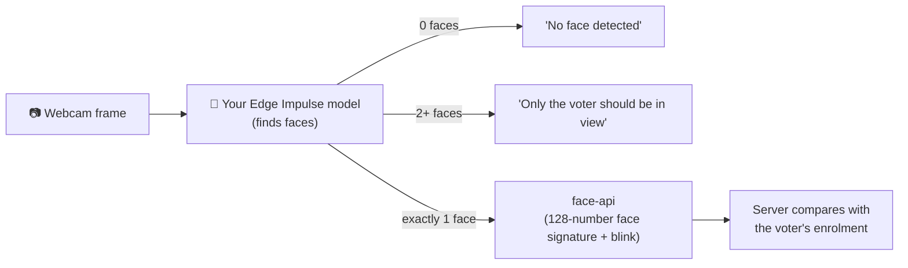
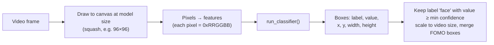

<div align="center">

# 🤖 Training the FaceVote Face Detector

**How to collect data, train a face-detection model in Edge Impulse, and plug it into the FaceVote app.**


</div>

---

## Contents

1. [What you are building](#1-what-you-are-building)
2. [Before you start: consent & privacy](#2-before-you-start-consent--privacy)
3. [Collecting the dataset](#3-collecting-the-dataset)
4. [Creating the Edge Impulse project](#4-creating-the-edge-impulse-project)
5. [Uploading and labelling](#5-uploading-and-labelling)
6. [Designing the impulse](#6-designing-the-impulse)
7. [Training](#7-training)
8. [Testing](#8-testing)
9. [Exporting to WebAssembly](#9-exporting-to-webassembly)
10. [Plugging the model into FaceVote](#10-plugging-the-model-into-facevote)
11. [Updating the model card](#11-updating-the-model-card)
12. [Tuning in the app](#12-tuning-in-the-app)
13. [Troubleshooting](#13-troubleshooting)
14. [Checklist for your report](#14-checklist-for-your-report)

---

## 1. What you are building

An **object-detection** model with **one label: `face`**. It runs in the voter's browser as WebAssembly and answers one question for every webcam frame: *where are the faces, and how many are there?*



**Why detection, not "recognise voter V001"?** A classifier with one class per voter would need retraining every time someone registers, and it always picks the closest class, even for a stranger. Detection never needs retraining for new voters. Identity is handled separately by face embeddings and checked on the server.

> **Until your model is ready, the app runs a demo model.** It returns exactly the same output format as an Edge Impulse export, so you can demo the whole flow today. The admin console's **AI model** page shows which detector is active.

## 2. Before you start: consent & privacy

Face images are **biometric personal data** (Rwanda's Law No. 058/2021 on personal data protection; the GDPR in the EU).

- [ ] Every volunteer signs a short **consent form**: what you collect, why, where it's stored, and when it will be deleted.
- [ ] Keep raw images in a local `dataset/` folder in the project. It is **git-ignored**. **Never commit or share face images.**
- [ ] Upload only to your own private Edge Impulse project.
- [ ] Delete the images (locally and in Edge Impulse) when the project ends.

## 3. Collecting the dataset

### How much

| | Target | Why |
| --- | --- | --- |
| Volunteers | **3–10 people** | Variety of faces, skin tones, hairstyles |
| Face images | **150–300** | Enough for FOMO to generalise |
| "No face" (background) images | **30–50** | Teaches the model what *not* to fire on |
| Images with 2 people | **10–20** | Lets you test the "more than one face" rule |

### What to vary (this matters more than quantity)

| Vary | Examples |
| --- | --- |
| **Lighting** | Daylight by a window, indoor lamp, dim room, backlit |
| **Distance** | Close (face fills ~60% of the frame) to arm's length (~20%) |
| **Angle** | Straight on, slight left/right turn, slight up/down |
| **Accessories** | Glasses on/off, headscarf, cap |
| **Background** | Plain wall, classroom, outdoors, busy background |
| **Expression** | Neutral, smiling, eyes closed (people blink during verification!) |

### How to capture

**Option 0: from the FaceVote admin console (recommended, already labelled).**
FaceVote is connected to your Edge Impulse project through the **Ingestion API**, which works on the free plan.

1. In Edge Impulse Studio open your project → **Dashboard → Keys** and copy the **API key**.
2. Put it in `.env` as `EDGE_IMPULSE_API_KEY="ei_…"`, then restart the server. **Admin → Integrations** should show *Connected* with your project name.
3. Open **Admin → Data collection**:
   - give each volunteer an anonymous **subject code** (`VOL-01`, `VOL-02`…), never their name;
   - tick **Consent form signed**;
   - press **Capture face** or **Burst ×5** while they change angle, distance and lighting;
   - point the camera away from people and press **Capture background** 30–50 times.
4. Each image arrives in Edge Impulse **already labelled**: the face boxes found by the app's detector are sent as a `bounding_boxes.labels` file. About 80% go to the training set and 20% to the testing set.
5. In Studio, open **Labeling queue / Data acquisition** and **review every box**. Fix or delete bad ones. Auto-labels are a starting point, not ground truth.

During voter registration (**Admin → Voters**) the officer can also tick *"The voter also agrees to share the captured images for model training"* to add that voter's 3 samples to the dataset. They are uploaded under the voter number, never under the name or National ID.

> FaceVote keeps **no copy** of these images. Only Edge Impulse stores them, so you control them in Studio and can delete them there.

**Option A: straight into Edge Impulse.** In your project go to **Data acquisition → Connect a device → Use your computer** (or scan the QR code with your phone). Capture photos directly. They upload automatically.

**Option B: your own photos.** Use a phone or laptop webcam and save JPG/PNG files into:

```
dataset/
├── faces/          # one or more faces per image
└── background/     # no faces at all
```

**Tips**

- Capture at the **same kind of camera** the app will use (a laptop webcam) for at least half of the images.
- Take several shots per person per setting, moving slightly between shots. Avoid 20 identical frames.
- Make sure each face is **sharp**. Delete blurry images.

## 4. Creating the Edge Impulse project

1. Sign up / log in at **https://studio.edgeimpulse.com**.
2. **Create new project** → name it **FaceVote Detector** → choose **Personal**.
3. On the dashboard, under **Project info**, set the **labelling method** to **Bounding boxes (object detection)**.

## 5. Uploading and labelling

1. **Data acquisition → Upload data**.
2. Select all files from `dataset/faces/` and `dataset/background/`.
3. Choose **Automatically split between training and testing** (80 / 20).
4. Leave the label empty. You'll draw boxes next.
5. Open the **Labeling queue**:
   - Draw a tight box around **every face** and give it the label **`face`** (lowercase, exactly this word; the app looks for "face" in the label).
   - Include the whole face from forehead to chin; ears optional.
   - For background images, **don't draw anything**. Just click **Save labels**.
   - Turn on **Track objects between frames / AI-assisted labelling** to speed this up. Always check its boxes.

> ✅ When you're done, **Data acquisition** should show roughly an 80/20 split, and every face image should have at least one `face` box.

## 6. Designing the impulse

**Impulse design → Create impulse**

| Block | Setting | Why |
| --- | --- | --- |
| Image data | **96 × 96** (or 160 × 160 for more accuracy, slower) | Small input = fast in the browser |
| Resize mode | **Squash** | The app squashes webcam frames to the model size; they must match |
| Processing block | **Image** | |
| Learning block | **Object Detection (Images)** | |

Click **Save Impulse**, then:

1. **Image** (left menu) → Colour depth: **Grayscale** (smaller, faster, works well for faces) or **RGB** → **Save parameters**.
2. **Generate features**. The *feature explorer* should show face samples clustering apart from background.

## 7. Training

**Object detection** (left menu):

| Setting | Value |
| --- | --- |
| Model | **FOMO (Faster Objects, More Objects) MobileNetV2 0.35** |
| Training cycles | 60 (raise to 100 if the F1 score is still improving) |
| Learning rate | 0.001 |
| Data augmentation | **On** |

Click **Start training**. When it finishes, **screenshot for your report**:

- the **F1 score** (aim for **≥ 0.85**)
- the **confusion matrix** (`background` vs `face`)
- the **on-device performance** (inference time, RAM, flash)

> FOMO doesn't draw full boxes. It marks the **centre** of each face on a grid, so one face can produce a few small boxes. The app merges nearby boxes automatically (`mergeNearbyBoxes()` in `src/lib/face-pipeline.ts`) and then crops generously around the centre.

## 8. Testing

1. **Model testing → Classify all.** Note the **accuracy on the test set** (images the model never saw).
2. **Live classification** → test with your webcam or phone, in new lighting and with new people.
3. Look at the failures. If the model misses faces in dim light, collect more dim-light images and retrain. That loop is the core of the project.

## 9. Exporting to WebAssembly

1. **Deployment** (left menu) → search **WebAssembly** → select **WebAssembly (browser)**.
2. Keep **Quantized (int8)** selected (smaller and faster).
3. Click **Build** and download the `.zip`.

## 10. Plugging the model into FaceVote

1. Unzip the download.
2. Copy **these two files** into `public/models/edge-impulse/` (next to `model-card.json`):

   ```
   public/models/edge-impulse/
   ├── edge-impulse-standalone.js     ← from the zip
   ├── edge-impulse-standalone.wasm   ← from the zip
   └── model-card.json                ← already there; update it in step 11
   ```

3. Check `.env`:

   ```env
   NEXT_PUBLIC_USE_EDGE_IMPULSE="true"
   ```

4. Restart the dev server (`npm run dev`).
5. Sign in to the admin console and open **AI model**. The status badge should change from **Demo model active** to **Trained Edge Impulse model active**, and the camera badge should read **Detector: Edge Impulse**.

That's it: no code changes. The demo model and your exported model produce the same output format (boxes labelled `face` in model-input pixels), so verification, enrolment and voting work unchanged.

### How the app runs your model (`src/lib/edge-impulse.ts`)



> If your export behaves differently, compare `src/lib/edge-impulse.ts` with `run-impulse.js` from the zip. That file is the official reference for your exact export.

## 11. Updating the model card

`public/models/edge-impulse/model-card.json` is what the admin dashboard shows on the **Overview** and **AI model** pages. It currently holds **sample values** for the demo. After training, replace them with **your** numbers from Edge Impulse:

| Field in `model-card.json` | Where to find it in Edge Impulse |
| --- | --- |
| `metrics.f1`, `metrics.precision`, `metrics.recall` | Object detection page → model performance (validation set) |
| `metrics.testAccuracy` | Model testing → accuracy (as a decimal, e.g. 0.904) |
| `confusionMatrix.rows` | Object detection page → confusion matrix (percentages) |
| `dataset.*` | Data acquisition → counts per split; your volunteer count |
| `input.*` | Impulse design (size, resize mode) + Image block (colour depth) |
| `training.*` | Object detection training settings |
| `onDevice.*` | Object detection page → on-device performance |

Then set:

```json
"isSample": false
```

The "sample metrics" warnings disappear from the dashboard.

## 12. Tuning in the app

Open **Admin → AI model → Live test bench**:

| What | Where | Typical fix |
| --- | --- | --- |
| Detection confidence | "Confidence" row | Raise/lower `NEXT_PUBLIC_EDGE_IMPULSE_MIN_CONFIDENCE` (default `0.6`) |
| Speed | "Frames / sec" row | Use 96×96 + Grayscale; close other tabs |
| Blink detection | "Eye aspect ratio" + "Blinks counted" | Adjust the `0.72` / `0.88` factors in `createBlinkDetector()` |
| Match threshold | "Face distance tester" | Set `FACE_MATCH_THRESHOLD` (default `0.5`) in the gap between "same person" and "different person" distances |

Then check **Admin → Verification log → Face distance distribution** after real test runs: genuine voters (blue) should sit left of the threshold line and impostors (orange) to the right.

## 13. Troubleshooting

| Problem | Fix |
| --- | --- |
| Badge still says **Demo model** | Both `.js` and `.wasm` must be in `public/models/edge-impulse/` with the exact names above. Restart `npm run dev` and hard-refresh the browser (Ctrl+Shift+R) |
| Model loads but never detects a face | Lower `NEXT_PUBLIC_EDGE_IMPULSE_MIN_CONFIDENCE` to `0.4`. Check that your label is `face`. Check that resize mode was **Squash** |
| Detects faces on walls / objects | Add more background images and retrain |
| Misses faces in dim light | Add more dim-light images and retrain |
| "More than one face" with one person | FOMO boxes too far apart to merge. Raise the merge distance in `fromModelSpace()` (`* 0.2` → `* 0.3`) |
| Browser console: wasm MIME type error | `next.config.ts` already serves `.wasm` as `application/wasm`. Restart the server after copying files |
| Classification failed (code …) | The export doesn't match the expected API. Compare with `run-impulse.js` from the zip |

## 14. Checklist for your report

- [ ] Signed consent forms (count, not the forms themselves)
- [ ] Dataset table: volunteers, face / background images, train / test split, conditions covered
- [ ] Impulse design screenshot (input size, resize mode, blocks)
- [ ] Training settings + **F1 score** + **confusion matrix** screenshot
- [ ] **Test-set accuracy** + live-classification observations
- [ ] On-device performance (inference ms, RAM, flash)
- [ ] App screenshots: **AI model** page with *Trained Edge Impulse model active*
- [ ] **FAR / FRR** from the in-app testing checklist (see the main README §16) and the distance histogram
- [ ] Limitations: lighting sensitivity, blink liveness vs video replay, demographic bias. What would you improve?
